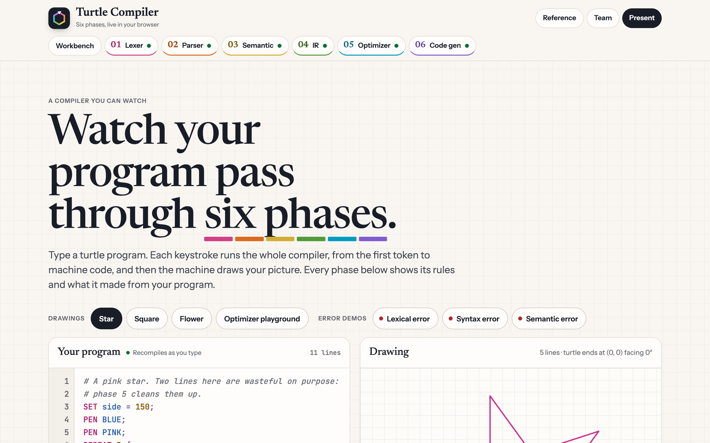
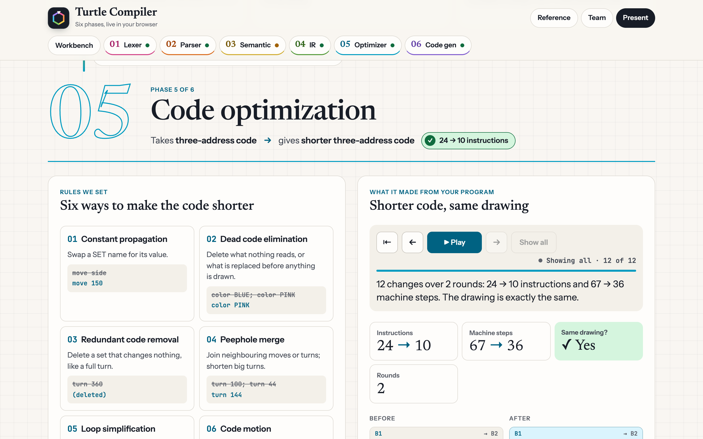
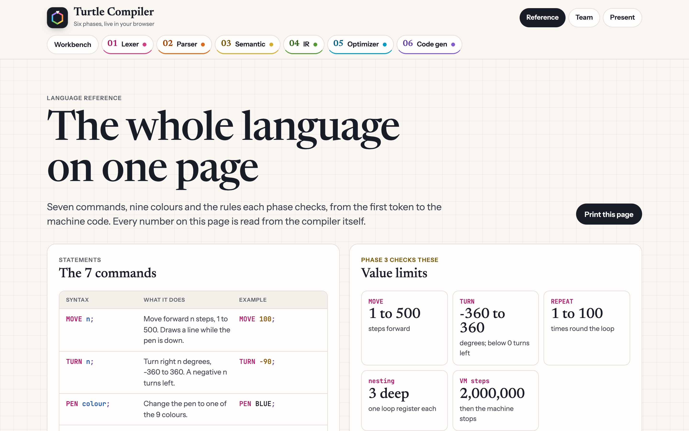
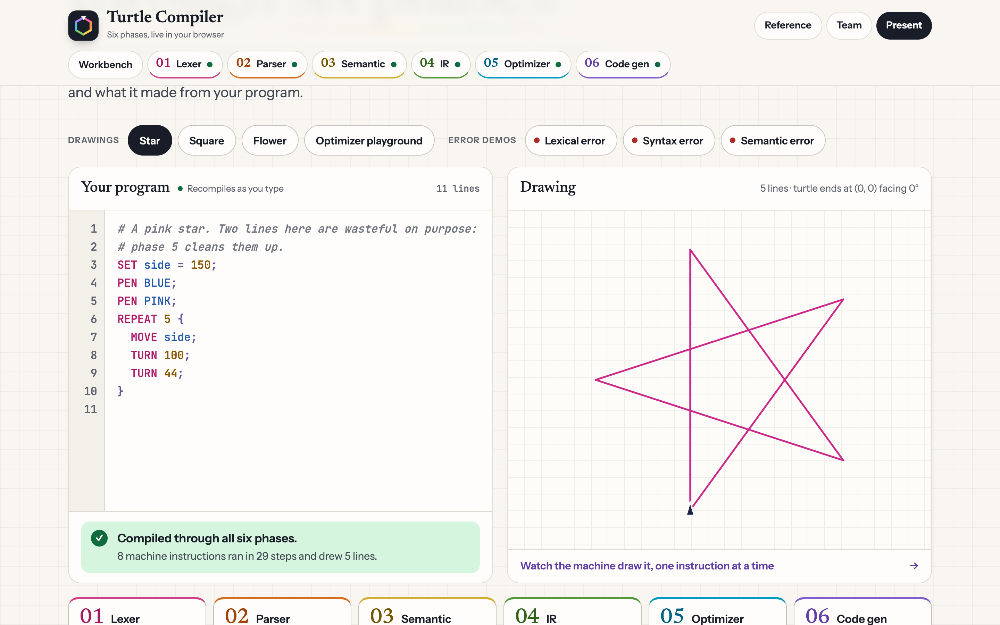

# Turtle Compiler

**A compiler for a small turtle-graphics language that you can watch work.** Type a program and all six phases of a real compiler run on every keystroke: lexical analysis, syntax analysis, semantic analysis, intermediate code generation, code optimization and code generation for a small virtual machine, which then draws the picture.

**Live site: [turtle.muralimadhav.com](https://turtle.muralimadhav.com)**



```
SET side = 150;
PEN PINK;
REPEAT 5 {
  MOVE side;
  TURN 144;
}
```

## Highlights

- **Six phases, every output visible.** Tokens, the LL(1) parse table and trace, the parse tree, the symbol table, three-address code, each optimization step and the final machine code are all shown on the page.
- **Rules you can read.** Each phase lists the rules it applies, and every check, rewrite and error message points back to one of them.
- **Runs entirely in the browser.** Nothing is sent to a server. The compiler is one plain JavaScript file with no dependencies.
- **Same compiler on the command line.** `turtlec` prints any phase, saves the drawing as SVG and writes machine code that it can run again.
- **Checked end to end.** After optimizing, both versions are run on the VM to confirm they draw exactly the same picture, and the CLI has its own test suite.

## The six phases

| # | Phase | Input → output | How it works |
| --- | --- | --- | --- |
| 1 | Lexical analysis | characters → tokens | Regular-expression rules with maximal munch. Comments and whitespace are skipped, and every token keeps its line and column. |
| 2 | Syntax analysis | tokens → parse tree | Table-driven LL(1) parser. FIRST and FOLLOW sets and the parse table are computed from a 12-rule grammar, and the stack trace is shown step by step. |
| 3 | Semantic analysis | parse tree → checked tree + symbol table | Rules S1–S8 (names defined once and before use, valid colours, value ranges, nesting depth) plus warnings W1–W2. |
| 4 | Intermediate code | checked tree → three-address code | `REPEAT` becomes a counter, two labels and a conditional jump. Also shown as quadruples and basic blocks. |
| 5 | Code optimization | three-address code → shorter three-address code | Rules O1–O6, run until nothing changes, then checked by running both versions on the VM. |
| 6 | Code generation | three-address code → machine code | 11 opcodes in 4-byte instructions, loop counters in registers R1–R3, and jump targets filled in with two-pass backpatching. |

### Optimizations

| Rule | Name | Example |
| --- | --- | --- |
| O1 | Constant propagation | `move side` → `move 150` |
| O2 | Dead code elimination | `color BLUE; color PINK` → `color PINK` |
| O3 | Redundant code removal | `turn 360` is deleted |
| O4 | Peephole merge | `turn 100; turn 44` → `turn 144` |
| O5 | Loop simplification | `REPEAT 1 { … }` → its body |
| O6 | Code motion | a `PEN` set once at the top of a loop body moves in front of the loop |



## The language

| Statement | Meaning |
| --- | --- |
| `MOVE n;` | Move forward `n` steps (1 to 500), drawing while the pen is down. |
| `TURN n;` | Turn right `n` degrees (−360 to 360). Negative turns left. |
| `PEN colour;` | Pick one of 9 colours: `RED ORANGE YELLOW GREEN CYAN BLUE PURPLE PINK WHITE`. |
| `PENUP;` / `PENDOWN;` | Stop or start drawing. |
| `SET name = n;` | Name a constant. Each name can be set once. |
| `REPEAT n { … }` | Run the body `n` times (1 to 100), nested at most 3 deep. |

Comments start with `#`. The [language reference](https://turtle.muralimadhav.com/reference/) lists the full grammar, every rule and the VM instruction set.



<details>
<summary>Grammar (LL(1))</summary>

```
program    → stmt_list
stmt_list  → stmt stmt_list | ε
stmt       → MOVE value ;
           | TURN value ;
           | PEN IDENT ;
           | PENUP ;
           | PENDOWN ;
           | SET IDENT = NUMBER ;
           | REPEAT value { stmt_list }
value      → NUMBER | IDENT
```

</details>

## Getting started

Needs Node.js 20 or newer.

```bash
git clone https://github.com/HackHeroic/turtle-compiler.git
cd turtle-compiler/web
npm install
npm run dev          # http://localhost:3000
```

`npm run build` writes the static site to `web/out/`.

### Command line

```bash
node cli/turtlec.js examples/star.turtle                     # report of all six phases
node cli/turtlec.js examples/star.turtle --phase opt         # one phase in full detail
node cli/turtlec.js examples/star.turtle --svg star.svg --bin star.tvm
node cli/turtlec.js run star.tvm                             # run saved machine code
```

Errors are reported as `file:line:col` with the source line, a caret and a hint. See [`cli/README.md`](cli/README.md) for every option.



## Project structure

```
compiler/compiler.js   The compiler: all six phases and the Turtle VM, shared by the site and the CLI
web/                   The website (Next.js, static export)
  app/                 Routes: /, /reference, /team, /present
  dc/                  Page components generated from the design files, plus their small runtime
  tools/               dc2jsx (design → React converter) and pixel-diff (visual regression check)
cli/                   turtlec, the command-line compiler, and its tests
design/                Source design files the pages are generated from (Claude Design format)
examples/              Example programs, including one error demo for each phase that can fail
demo/                  The first interactive prototype
docs/                  Screenshots used in this README
```

## Testing

```bash
node --test cli/test                 # CLI tests: every phase, errors, SVG, machine code round trip
cd web && node tools/pixel-diff.mjs  # site vs. design, pixel by pixel
```

The pixel check renders each design file and the built page in headless Chrome at 1440 px and 390 px wide, in every example state, and compares them. It needs Google Chrome, `npm run build` first, and Claude Design's runtime: export the project from Claude Design and copy its `support.js` into `design/` (it isn't part of this repo). Set `SITE_URL` to check a deployed site instead of the local build.

## Tech stack

- **Compiler:** plain JavaScript, no dependencies, runs in the browser and in Node.js
- **Website:** Next.js 16 and React 19, statically exported
- **Hosting:** Cloudflare Pages, deployed on every push to `main`
- **Tooling:** parse5 for the design converter; Playwright, pixelmatch and pngjs for visual tests

## Team

| Name | GitHub |
| --- | --- |
| C Murali Madhav | [@HackHeroic](https://github.com/HackHeroic) |
| Pugazhendhi J | [@pugazhjs9](https://github.com/pugazhjs9) |
| Tejmul Movin | [@Tejmul](https://github.com/Tejmul) |
| J Amathziah | [@amathziah](https://github.com/amathziah) |
| Ravi Yadav | [@RAVIYADAV6522](https://github.com/RAVIYADAV6522) |

Built as the project for the Compiler Design and Automata course.

## License

[MIT](LICENSE)
